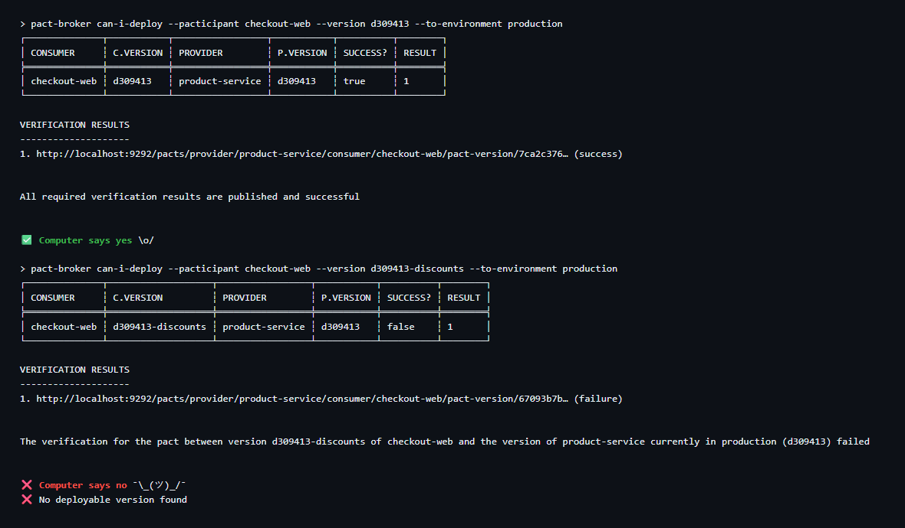
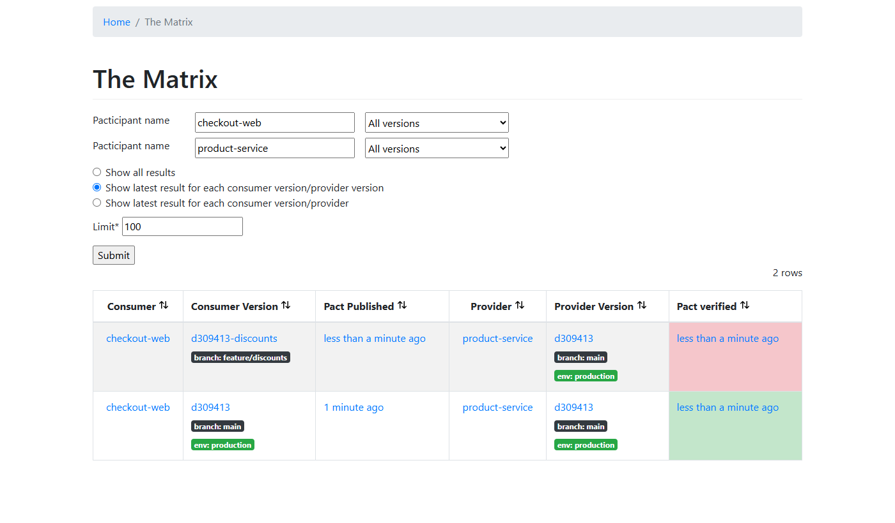

# Pact Contract Testing: TypeScript consumer, Java provider

[](https://github.com/niranjankagri/pact-contract-testing/actions/workflows/contract.yml)

Consumer-driven contract testing with [Pact](https://docs.pact.io) between two services in two languages:

- **checkout-web** (consumer): a TypeScript checkout client that calls the product API;
- **product-service** (provider): a Java 17 Spring Boot 4 API for products and stock reservations;
- a **self-hosted Pact Broker** (Docker) that stores contracts and verification results and answers
  **can-i-deploy**.

The whole workflow runs with one command locally and in GitHub Actions, including a demo of a breaking change
that the broker stops before it reaches production.

## Why contract tests

End-to-end tests of two services need both deployed together: slow, flaky, and late. Contract tests split the
problem:

1. The **consumer** writes down what it needs, as tests against a Pact mock server. The interactions it uses
   become the **contract** (a pact file).
2. The **provider** replays that contract against its real code and checks every answer.
3. The **broker** remembers which versions passed against which, so a pipeline can ask before deploying:
   _can this version go to production with what is already there?_

Each side tests alone, in seconds, and a breaking change is caught in the build of the team that makes it.

## What it shows

| Topic                                                                                                                      | Where                                                |
| -------------------------------------------------------------------------------------------------------------------------- | ---------------------------------------------------- |
| Pact V4 consumer tests with matchers (`integer`, `decimal`, `uuid`, ISO-instant regex, `eachLike`)                         | `checkout-web/test/pact/productService.pact.test.ts` |
| Provider states **with parameters** (`given('a product exists', { id, price, stock })`)                                    | consumer tests + `ProductPactVerificationBase.java`  |
| Auth in contracts: any Bearer token in the pact, a request filter injects a valid one (and keeps the 401 case without one) | `ProductPactVerificationBase.java`                   |
| Error contracts: 401, 404, 409 with `available`                                                                            | consumer tests                                       |
| Tolerant reader: the consumer copies only the fields it uses                                                               | `checkout-web/src/productClient.ts`                  |
| Provider verification with JUnit 5 + Spring Boot on a random port                                                          | `product-service/src/test/.../pact/`                 |
| Verification from the pacts folder (local) or the broker (CI), chosen by one variable                                      | `ProductPactFolderTest`, `ProductPactBrokerTest`     |
| Consumer version selectors: main branch, deployed/released, matching branch                                                | `ProductPactBrokerTest.java`                         |
| **Pending and WIP pacts**: a consumer's new expectation never breaks the provider's build                                  | `ProductPactBrokerTest.java`, breaking demo          |
| Publishing, verification results, `can-i-deploy`, `record-deployment`, environments                                        | `scripts/contract-flow.mjs`                          |
| Breaking-change demo: provider stays green, consumer blocked, reason checked                                               | `scripts/breaking-change-demo.mjs`                   |
| Self-hosted Pact Broker + PostgreSQL in Docker Compose                                                                     | `broker/docker-compose.yml`                          |
| CI: consumer and provider jobs, then the full broker workflow, matrix on the run page                                      | `.github/workflows/contract.yml`                     |
| Mutation checks: renaming a field in the provider fails verification with the field's name                                 | see "Results"                                        |

## The contract

checkout-web needs six interactions from product-service:

| Interaction      | Provider state                                 | Request                                       | Expected response                                                          |
| ---------------- | ---------------------------------------------- | --------------------------------------------- | -------------------------------------------------------------------------- |
| one product      | a product exists {id 1, price 19.99, stock 25} | `GET /products/1` + Bearer                    | 200 `{id, name, price {amount, currency}, stock}`                          |
| missing product  | no product exists {id 999}                     | `GET /products/999` + Bearer                  | 404 `{error}`                                                              |
| products by ids  | products exist {ids [1, 2]}                    | `GET /products?ids=1,2` + Bearer              | 200 `{products: [ ... ]}` (at least one)                                   |
| reserve stock    | a product exists {id 1, stock 25}              | `POST /products/1/reservations {quantity: 2}` | 201 `{reservationId (UUID), productId, quantity, expiresAt (ISO instant)}` |
| not enough stock | a product exists {id 2, stock 1}               | `POST /products/2/reservations {quantity: 5}` | 409 `{error, available}`                                                   |
| no token         | a product exists {id 1}                        | `GET /products/1` without Authorization       | 401 `{error}`                                                              |

The provider returns more fields (`description`, `category`, `createdAt`). The consumer does not use them, so
they are not in the contract, and product-service may change them freely. That is what "consumer-driven" means.

**Why both services are in this repository:** the tests run against their own copies, started fresh for every run,
locally and in CI. No shared or hosted environment means no outages, no test data shared between runs, and no change
somewhere else that breaks these tests; one clone and one command run everything. Both sides of the contract are here,
so the whole workflow (publish, verify, can-i-deploy) runs without real teams or deployed services.

## Project structure

```
checkout-web/                    CONSUMER (TypeScript, Node 24)
  src/productClient.ts           HTTP client: typed errors for 401/404/409, tolerant reader
  src/checkout.ts                price a basket (in cents), reserve its stock
  test/pact/                     Pact V4 contract tests (+ the discounts feature for the demo)
  test/unit/                     checkout logic with a fake client
product-service/                 PROVIDER (Java 17, Spring Boot 4.1, Maven wrapper)
  src/main/java/.../product      GET /products/{id}, GET /products?ids=&category=
  src/main/java/.../reservation  POST /products/{id}/reservations
  src/main/java/.../api          error bodies, Bearer token filter, clock
  src/test/java/.../pact         Pact verification: base (states, request filter), folder test, broker test
broker/docker-compose.yml        Pact Broker 2.121 + PostgreSQL 17
scripts/                         contract-flow.mjs, breaking-change-demo.mjs, summary.mjs, lib.mjs
.github/workflows/contract.yml   CI
docs/                            framework design, interview guide, images
```

## Run it

Needs Node 24, Java 17+ (`JAVA_HOME` set) and Docker.

```bash
npm ci && npm ci --prefix checkout-web

npm run contract        # broker up, consumer tests, publish, provider verification, can-i-deploy, record deployment
npm run demo:breaking   # after "contract": a consumer feature the provider does not support yet
npm run broker:down     # stop the broker and delete its data
```

The broker UI is at http://localhost:9292 while it runs.

Each side on its own (no broker needed):

```bash
cd checkout-web && npm test                 # 6 unit + 6 contract tests, writes pacts/checkout-web-product-service.json
cd product-service && ./mvnw test           # 10 own tests + verification of the pact file in pacts/
```

## The workflow, step by step

1. **Consumer tests** run the real `ProductClient` against Pact's mock server. When they pass, Pact writes the
   pact file.
2. **Publish** the pact to the broker with the consumer's version (the git commit) and branch.
3. **Provider verification**: Spring Boot starts product-service on a random port; for each interaction Pact
   sets up the provider state, sends the request (with a valid token injected) and compares the answer with the
   contract; the results go back to the broker with the provider's version and branch.
4. **can-i-deploy product-service** to production: are all consumers in production compatible with this
   version? Then **record-deployment**.
5. **can-i-deploy checkout-web** to production: has this version been verified against the provider version in
   production? Then **record-deployment**.

## The breaking-change demo

On branch `feature/discounts`, checkout-web starts expecting a `discountPercent` field that product-service does
not send.

- The consumer's tests pass: they run against the mock server, which returns what the contract says.
- The new contract is published from the feature branch.
- product-service's normal build verifies it as a **WIP / pending** pact: the verification fails, but the
  provider's build stays green, because a consumer's unfinished feature must not block the provider team. The
  failure is still recorded in the broker.
- `can-i-deploy` for the consumer's feature version says **no**. The script also checks the reason (a failed
  verification), so a "no" for any other reason does not count as success.



The broker's matrix after both runs: the main version verified and deployed, the feature version failed.



## Results

- **Consumer:** 12 tests (6 contract, 6 unit), about 3 s.
- **Provider:** 10 own tests + 6 verified interactions.
- **Full workflow locally:** about 35 s with the broker already running.
- **CI:** all three jobs green, about 1.5 minutes; the run page shows the broker matrix.
- **Mutation checks** (temporary changes, reverted):
  - renaming `available` in the provider's 409 body fails verification with
    `Actual map is missing the following keys: available`;
  - the discounts demo fails with `Actual map is missing the following keys: discountPercent`.

## CI

`.github/workflows/contract.yml`, on every push and pull request to `main` and by hand:

1. **Consumer** (lint, typecheck, unit + contract tests, pact file as an artifact) and **Provider**
   (`./mvnw test` on Temurin 17) in parallel.
2. **Pact workflow with broker**: Docker Compose broker, `npm run contract`, `npm run demo:breaking`, and the
   broker's matrix as a table on the run's summary page.

The consumer and provider test results are kept as JUnit XML (`junit-consumer`, `junit-provider`), which
[Automation Coverage & Quality Intelligence](https://github.com/niranjankagri/automation-coverage-quality-intelligence) collects. `main` is protected by a ruleset: every change goes through a pull request, and the CI jobs above must pass before it is merged.

In real life the two services live in separate repositories with one long-lived broker. A broker **webhook**
(`contract_requiring_verification_published`) then starts the provider's verification when a changed contract is
published, and each pipeline runs `can-i-deploy` before its own deployment.

## Design notes

- **Contract tests are not functional tests of the provider.** The provider's own tests (`ProductApiTest`) check
  its behaviour in detail; the contract checks only what the consumer relies on.
- **Matchers, not exact values.** The provider only has to return the right types and formats, so its test data
  does not have to copy the consumer's examples.
- **Provider states with parameters** keep the state names generic ("a product exists") and the data in the
  contract.
- **The token**: the consumer cannot know a valid provider token, so the contract allows any Bearer token, and
  the provider's verification replaces it; the interaction without a token keeps none, so its 401 is really
  tested.
- **One version per commit.** Both services use the git commit as their version; the broker needs a unique,
  traceable version per build.

More: [docs/framework-design.md](docs/framework-design.md).

## Interview guide

Contract testing and Pact questions, each answered with a pointer to this project:
[docs/interview-questions.md](docs/interview-questions.md) (also as [PDF](docs/interview-questions.pdf)).

## Known limitations

- One consumer; a second consumer (for example a warehouse app) would show the provider verifying several
  contracts at once.
- The broker in CI is new for every run, so pacts are always "pending" there on the first verification; the
  gate is `can-i-deploy`, which is what pipelines rely on anyway.
- The broker has no authentication (local demo); a shared broker needs basic auth or tokens.
- No message (event) contracts yet; Pact supports them too.

## License

[MIT](LICENSE)
